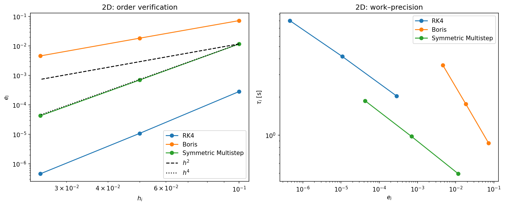
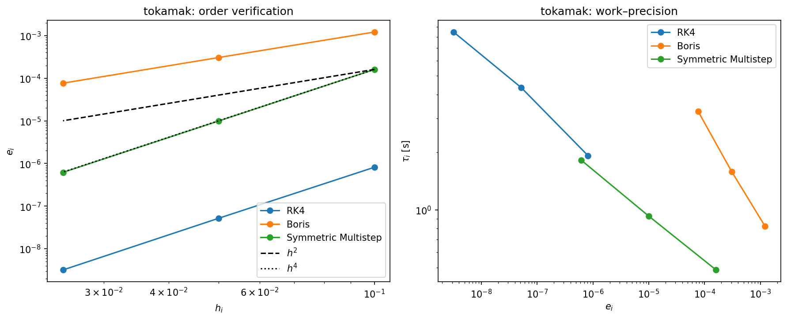

## Task B: Order verification and work–precision diagrams

### Setup

For both systems we run all three methods with the step sizes

$$h_i = \frac{h}{2^i}, \qquad i = 0, 1, 2, \qquad h = 0.1,$$

that is $h_i = 0.1,\ 0.05,\ 0.025$, up to the fixed end time $T = 10^3$ (the task allows a shorter interval than in Task A). The global error is measured at the end time,

$$e_i^{\text{method}} = \big\| x^{\text{method}}_{(N_i)} - x^{\text{ref}}(T) \big\|_2, \qquad T = h_i N_i .$$

The reference solution $x^{\text{ref}}(T)$ is computed with `solve_ivp` on system (1), using `DOP853` (an adaptive Runge–Kutta method of order 8) with `rtol = atol = 1e-12`. It is computed once per system and reused for every method and step size, since $T$ is the same in all runs. The runtime $\tau_i$ of each method is measured with `time.perf_counter()` and includes everything the method does, also the start-up (the half step backwards for Boris and the eight starting values for the multistep method).

**Why a log–log plot shows the order.** If $e \approx C h^p$, then $\log e = \log C + p \log h$, which is a straight line with slope $p$. When the step size is halved, the error is divided by $2^p$, so the observed order can be estimated as

$$p_i \approx \log_2 \frac{e_{i-1}}{e_i}.$$

The expected orders are $p = 4$ for RK4, $p = 2$ for Boris and $p = 4$ for the symmetric multistep method.

### Results

Observed orders $p_1, p_2$ (from halving $h$ from 0.1 to 0.05, and from 0.05 to 0.025):

| Method | 2D | Tokamak | Expected |
|---|---|---|---|
| RK4 | 4.71, 4.56 | 3.97, 4.03 | 4 |
| Boris | 1.98, 2.00 | 1.99, 2.00 | 2 |
| Symmetric multistep | 4.07, 4.03 | 4.01, 4.00 | 4 |

### Comments

#### Order of convergence

We managed to verify the expected orders for all three methods on both systems. In the log–log plots all curves are straight lines, Boris is parallel to the $h^2$ reference line, and RK4 and the symmetric multistep method are parallel to the $h^4$ line. The observed orders in the table are very close to 2 and 4.

The only deviation is RK4 on the 2D system, where the observed order is about 4.6 instead of 4. We think this is because the step sizes are not yet small enough for the error to be fully asymptotic: the error is $e = C h^4 + \mathcal{O}(h^5)$, and for $h = 0.1$ the higher-order terms still contribute. On the Tokamak system, RK4 gives 3.97 and 4.03. For a few more halvings of $h$ we would expect the 2D value to approach 4 as well.

We also checked that the reference solution is accurate enough. The smallest error we measure is $3.2 \cdot 10^{-9}$ (RK4 on the Tokamak system with $h = 0.025$), which is far above the tolerance $10^{-12}$ of the reference solution. If the reference solution were too inaccurate, the smallest errors would flatten out in the order plot. They do not, and RK4 keeps order 4 down to this error, so the reference solution does not affect the results.

#### Accuracy for a fixed step size

For the same step size, RK4 is clearly the most accurate method, followed by the symmetric multistep method and then Boris. With $h = 0.1$, the error of RK4 is $2.8 \cdot 10^{-4}$ against $1.2 \cdot 10^{-2}$ for the multistep method on the 2D system , and $8.2 \cdot 10^{-7}$ against $1.6 \cdot 10^{-4}$ on the Tokamak system, even though both methods have order 4. The difference is in the error constant $C$. Boris has order 2 and is therefore several orders of magnitude less accurate than the two fourth-order methods.

#### Work–precision: which method is most efficient?

Efficiency is not the runtime alone, but how much runtime a method needs to reach a given error. In the work–precision diagram the most efficient method is therefore the one whose curve lies lowest for a given error on the $x$-axis. These comparisons are also only for our implementations of the methods. We only update the nedded parameters for each computation, so the time spent should be close to optimal. 

The symmetric multistep method looks to be the most efficient, altough just barely. Its most prescise run achives both a lower computation time and error than the fastest RK4 run for both approximations, and its curve seems to stay lower. This makes sense considering that both methods curves should be parallel with a downward slope $ - 1/4 $ in the log plot, since they are fourth order methods. So we can expect The symmetric multistep method to achive lower computation time for the same error, given that it beats out RK4 for the one error.  
The Boris method is much less efficient in the whole range we measured, its curve lies above the others everywhere. Its slope is $ - 1/2 $, instead of $ - 1/4 $, so the gap will also grow larger as the error tolerance decreases. 

The efficiency results were mostly as expected: higher order pays off when high accuracy is needed, and a method with few function evaluations per step is cheaper. What surprised us a little was how small the error constant of RK4 is compared to the multistep method, which makes RK4 almost as efficient as the multistep method on the Tokamak system even tough it requires more computations.

### Conclusion

We verified the expected orders of convergence for all three methods on both systems: order 2 for Boris and order 4 for RK4 and the symmetric multistep method. The only deviation was RK4 on the 2D system, where the observed order of about 4.6 indicates that the error is not yet fully asymptotic for these step sizes.

For a fixed step size RK4 is the most accurate method, but it is also the most expensive per step. When accuracy and runtime are considered together, the symmetric multistep method is the most efficient, with RK4 close behind, especially on the Tokamak system. Boris is the least efficient in the whole range we measured. The work–precision curves have the slopes $-1/p$ predicted by the order, so the advantage of the fourth-order methods over Boris grows as the error tolerance decreases.

These results only concern accuracy at a fixed, fairly short end time. They do not say anything about the long-time behaviour, such as energy conservation, which is where the Boris method and the symmetric multistep method are expected to have an advantage over RK4 (see Task A).

